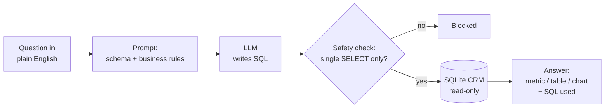

# 🔎 LeadLens: ask your CRM questions in plain English

**Live app:** https://leadlens-gunjan.streamlit.app

LeadLens turns a business question like *"Which lead source has the highest win rate?"*
into SQL, runs it on a sales CRM database, and returns the answer as a number,
table or chart, along with the SQL it used so the result can be checked.

Unlike most text-to-SQL demos, it is **measured**: a 50-question test set with
hand-checked answers scores every version of the prompt, so improvements are
proven rather than assumed.

| | |
|---|---|
| **Execution accuracy** | **50/50** on the test set (15 easy, 20 medium, 15 hard) |
| **First version** | 48/50. Failures were analysed and fixed (see below) |
| **Safety** | Read-only: only single `SELECT` queries run, on a read-only connection |
| **Data** | Fully synthetic CRM (1,200 leads, 948 deals, 7 tables). No real client data |

---

## The problem

Sales managers often wait on an analyst for simple questions: *How many leads
are unassigned? Which rep closes best in the North? How did revenue move month
to month?* Each one is a short SQL query, but only if you know SQL and the schema.
LeadLens lets anyone ask directly and get an answer in seconds, while showing
the query so an analyst can verify it.

## How it works



1. **Schema from the database.** The table definitions are read directly from
   SQLite, so the prompt always matches the real structure.
2. **Business rules in the prompt.** Definitions the model can't guess:
   revenue counts only *won* deals, win rate = won ÷ closed, amounts are INR.
3. **Deterministic generation.** `temperature=0`, so the same question gives
   the same SQL. This is what makes the evaluation repeatable.
4. **Two safety layers.** A keyword and statement check rejects anything but a
   single `SELECT`/`WITH` query, and the database is opened read-only, so even
   a missed case cannot change data.
5. **Readable output.** Single values show as a metric, monthly data as a line
   chart, categories as sorted bar charts, with the SQL and a CSV download.

## Evaluation

### Method: execution accuracy

Each test question has a reference SQL query written and checked by hand.
LeadLens gets only the question. Both queries are run, and LeadLens's answer
counts as **correct** if it returns the same rows and contains every reference
column.

Deciding what "the same answer" means took some thought:

- **Extra columns are allowed.** Returning *Referral, 63.3%* for "which source
  wins most?" is correct, even though the reference returns only *Referral*.
- **Names and order don't matter.** Column names, column order and row order
  are ignored.
- **Numbers are compared to 3 significant figures**, so 63.27% and 63.3% match.
- **Questions were written to have one right answer.** No ties for "top" items,
  and ambiguous terms are spelled out, for example *"region, based on the
  company's region"* (reps and companies both have a region).

### Results

| Prompt version | Easy | Medium | Hard | **Total** |
|---|---|---|---|---|
| v1: schema + business rules | 15/15 | 20/20 | 13/15 | **48/50 (96%)** |
| v2: + integer-division rule | 15/15 | 20/20 | 15/15 | **50/50 (100%)** |

Model: `gemini-3.5-flash-lite`. Full per-question results are in [`results/`](results/),
and the v1 failure report is in [`eval_report_v1.md`](eval_report_v1.md).

### What went wrong, and the fix

**Integer division (real error).** For *"won revenue divided by campaign budget"*,
the model wrote logically correct SQL (LEFT JOINs, won deals only, zero for
campaigns with no wins) but SQLite divides integers as integers:

| Campaign | LeadLens v1 | Correct |
|---|---|---|
| Instagram Ads Push Aug 2025 | 13.0 | 13.98 |
| Website Push Oct 2025 | 108.0 | 108.32 |
| Event Push Apr 2026 | 3.0 | 4.0 |

The model even tried to avoid it with `COALESCE(..., 0.0)`, but that only
applies when the sum is NULL. **Fix:** one prompt rule: *multiply by 1.0 before
any ratio, average or percentage.* The full set was then re-run to confirm the
fix broke nothing else: 50/50.

**API error (not a model error).** One question failed because the API
connection dropped. The evaluator now records these separately and can re-run
just those questions (`--rerun-errors`), so outages are never counted as
wrong answers.

### Limitations: read this before trusting 100%

- **The data is clean and synthetic.** Clear table and column names and no
  messy values make this easier than a real CRM. Expect lower accuracy on
  production data.
- **The test set has hit its ceiling.** At 50/50 it can no longer tell prompt
  versions apart. The next step is harder questions: vague wording, typos,
  questions the data cannot answer, and multi-step questions.
- **One model, one run.** Results are for `gemini-3.5-flash-lite` at
  temperature 0. Other models or versions may score differently.
- **The safety check is keyword-based.** The read-only connection is the real
  guarantee. A production system would also use a SQL parser and a
  dedicated read-only database user.

## Built for free-tier APIs

The app runs on Gemini's free tier, which has per-minute and per-day request
limits. LeadLens handles this deliberately:

- Busy (503) and per-minute (429) errors are **retried with exponential backoff**.
- A **daily-quota** error stops immediately instead of wasting retries.
- The evaluator **saves after every question** and resumes where it stopped.
- The web app **caches answers** to repeated questions and limits each session
  to 15 questions.
- The provider is **one config line**: any OpenAI-compatible API works
  (OpenAI, Gemini and others) by changing `LLM_BASE_URL` and `LLM_MODEL`.

## The data

`crm.db` is generated by [`generate_crm.py`](generate_crm.py) with a fixed
random seed, so it is identical on every run, which keeps the test answers valid.

| Table | Rows | Contents |
|---|---|---|
| `leads` | 1,200 | source, service, status, rep, created/closed dates |
| `deals` | 948 | closed leads: amount (INR), Won/Lost, loss reason |
| `activities` | 3,640 | calls, emails, meetings, demos per lead |
| `contacts` | 456 | people at client companies |
| `companies` | 220 | industry, city, region, size |
| `sales_reps` | 16 | region and manager (self-referencing) |
| `campaigns` | 10 | channel, dates, budget |

Realistic patterns are built in, so questions have meaningful answers:
referrals win about 63% of closed deals and cold calls about 12%, some reps
outperform others, deal size depends on the service, and some values are
missing (unassigned leads, contacts without phone numbers).

## Run it locally

```bash
git clone https://github.com/gunjanmalik560/leadlens.git
cd leadlens
python -m venv venv
venv\Scripts\activate            # Mac/Linux: source venv/bin/activate
pip install -r requirements.txt
```

Create a file named `.env` (never commit it) with your API key. A free key
is available from Google AI Studio:

```
LLM_API_KEY=your-key
LLM_MODEL=gemini-3.5-flash-lite
LLM_BASE_URL=https://generativelanguage.googleapis.com/v1beta/openai/
```

Then:

```bash
streamlit run app.py                                   # web app
python ask.py "Which industry brings the most revenue?" # terminal
python evaluate.py                                      # run the test set
python evaluate.py --report                             # show saved results
```

## Project structure

| File | Purpose |
|---|---|
| `app.py` | Streamlit web app |
| `core.py` | Question → prompt → SQL → safety check → answer |
| `evaluate.py` | Runs the test set and scores execution accuracy |
| `eval_questions.json` | 50 test questions with reference SQL |
| `results/` | Saved per-question results for each run |
| `generate_crm.py` | Builds the synthetic `crm.db` |
| `ask.py` | Ask a question from the terminal |
| `list_models.py` | Lists models available to your API key |

## Tech stack

Python · SQLite · pandas · Streamlit · Altair · OpenAI-compatible LLM API (Gemini)

## What I would do next

- A harder test set: ambiguous wording, typos and unanswerable questions, and
  measure how often the model correctly says "I can't answer that"
- Compare several models on cost, speed and accuracy
- Show the model a few example question-and-SQL pairs in the prompt, and
  measure whether that improves hard questions
- Run against a messier, real-world-style schema

---

Built by **Gunjan Malik**, M.Sc. Data Science · [GitHub](https://github.com/gunjanmalik560)
